<!-- coderabbit-ai-generated:v1 -->

<!-- coderabbit-ai-generated-section:v1:dde627c443ef3c15c8c043f063e24dc7672e730c38f31cc3ac43bb7b30cb0c2b -->

# DeskDrop incident demo: setup and architecture

This is the local Mac version of the Datadog → CodeRabbit → Slack demo. Jira creation and repository debugging are independent user choices. Start with the [Do / Say / See walkthrough](incident-walkthrough.md) for presentation; use this page for preparation and [the provider evidence](../automations/datadog-to-slack-mmani.md) for exact observed results. The [next phase](gcp-team-handoff.md) moves the runtime and trigger to Google Cloud for team use.

## What is ready

Verified November 5, 2026: Datadog TEST notifications reach the native MMANI automation, both Slack buttons render, Debug investigates the repository without a ticket, and Create Jira Ticket creates a verified SC Bug. The latest recorded run created [SC-41](https://coderabbit-demo.atlassian.net/browse/SC-41) after Debug completed. Debug reported 68 domain and three checkout browser tests passing on `main@80bf508`, with no reproduced defect and no PR.

The automatic real-alert trigger is a separate implementation described in [brief 12](../briefs/12-demo-guide-trigger.md). Its command examples below require reviewed implementation and verified live readiness before execution. The tested Datadog UI fallback is available now. The complete native CodeRabbit Code → fix PR → review → Verify path has not been demonstrated.

## Architecture

```mermaid
flowchart LR
  App[DeskDrop app on Mac Docker] -. Local monitoring unverified .-> Checks[HTTP and browser check runner]
  Checks -.-> Forwarder[Private DogStatsD forwarder]
  Forwarder -.-> Agent[Datadog Agent]
  Agent -. Agent health and intake unverified .-> DD[Datadog US3 checkout monitor]
  DD --> Hook[Native MMANI webhook automation]
  Hook --> Slack[CodeRabbit Demo / mmani-shopping-cart]
  Slack --> JiraButton[Create Jira Ticket]
  JiraButton --> Bug[Create or reuse SC Bug]
  Slack --> DebugButton[Debug and Create PR]
  DebugButton --> Repo[Investigate repository and reproduce]
  Repo -. Source defect and authenticated handoff required .-> Code[CodeRabbit Code]
  Code -.-> CLI[One CLI review for the new task]
  CLI -.-> PR[Fix PR in the same repository]
  PR -.-> Review[CodeRabbit PR feedback and CI]
  Review -.-> Verify[Native QA Agent Verify]
```

<!-- coderabbit-ai-generated:v1 -->

<!-- coderabbit-ai-generated-section:v1:1ccd2600932b7c2c726a9592ade5f777e141b74a38ada7a2c796b72f1617ca9e -->



Solid downstream paths were exercised using a Datadog TEST notification. The dashed Mac monitoring/Agent intake path remains unverified; the separate dashed implementation/review path also remains to be proved from the native Debug button. TEST evidence does not prove Agent health, intake or an actual app outage. No Jira edge feeds Debug. The separately implemented MMANI Demo Bridge Socket Mode receiver is paused and is not part of this architecture.


<!-- /coderabbit-ai-generated:v1 -->
## Resource map

| Resource | Current local value |
| --- | --- |
| Repository | [coderabbit-demo/mmani-shopping-cart](https://github.com/coderabbit-demo/mmani-shopping-cart) |
| App | `http://localhost:3177/`; Docker project `deskdrop-mmani-local` |
| Runtime controls | `scripts/demo/local.mjs`; protected state `~/.deskdrop-mmani-local` |
| Datadog site | `us3.datadoghq.com` |
| Checkout monitor | [29524290](https://us3.datadoghq.com/monitors/29524290) |
| Availability / heartbeat | `29524154` / `29524292` |
| Runtime identity | `service:deskdrop`, `env:local-demo`, `demo_id:mmani-shopping-cart-local`, `host:deskdrop-mmani-local` |
| Monitor ownership | `managed_by:deskdrop-local-controller` and the installation's protected `local_owner:` tag |
| Native automation | [Datadog to Slack Automation - MMANI](https://app.coderabbit.ai/automations/ui-c0ddcf9b-c9cb-4ae9-b52f-37e164997203) |
| Datadog route | `webhook-deskdrop-mmani-local`; rule `8e4ea5f2-29e7-410d-a4a3-b258c8fc30fc` |
| Slack | CodeRabbit Demo, `#mmani-shopping-cart`; team `T0AU433PG75`, channel `C0CEPB2LURY` |
| CodeRabbit scope | `mmani-shopping-cart`; scope `168d0e97-000e-4dc5-a118-0349a63fa266` |
| Jira | [ShoppingCart / SC](https://coderabbit-demo.atlassian.net/jira/software/projects/SC/boards/107), Bug type `10047` |
| QA environment | `mmani-ecommerce`; environment `9e39a80a-f443-4e73-9d4b-c21e34476315` |

A read-only check of the current rule returned its five-tag filter and expected webhook recipient, without a conditional-recipient/transition attribute. This does not establish Alert-only delivery; the automatic trigger must refuse to arm until that effective boundary is verified. No routing edit is part of the implementation brief.

The notification rule's ownership selector is separate from the service-check query's host and runtime tags. Retain both; a prompt to ignore unrelated events is not an ingress authorization boundary.

## Install and enroll a Mac

1. Use a reviewed committed checkout. Install Git, Docker Desktop, npm and Node 22.6 or newer; use the reviewed Node 24 toolchain where available. The future shell entry point must support macOS Bash 3.2. The application and checker image pins are in `deploy/runtime-versions.json`; do not silently update them.
2. Confirm GitHub access and the CodeRabbit CLI's `coderabbit-demo` organization. `coderabbit auth status`, `coderabbit doctor` and `coderabbit code ls --repo . --agent` are read-only readiness checks after authentication. Interactive login belongs to the operator. Mac CLI authentication is distinct from authentication inside CodeRabbit's Slack sandbox.
3. Create the ignored `.env.demo.local` in the checkout used by the local controller, with `DD_API_KEY`, `DD_APP_KEY`, and optionally `DD_SITE=us3.datadoghq.com`. Keep it a regular, current-user-owned mode-0600 file. `DD_APPLICATION_KEY` is a supported alias only when it agrees with `DD_APP_KEY`. The existing loader requires the protected file even if matching variables are exported. Keep values out of shell history, screenshots, Git, app containers and prompts.
4. The API key enables Agent intake; the application key needs the monitor read/write/downtime permissions required for the owned resources. It stays in the Mac management process. See [local Docker setup](local-docker.md) for reviewed secret-backend and image procedures.
5. Read the existing ownership journal before provisioning. Reuse the three recorded monitors. Do not run monitor `plan`/`apply` against an already-enrolled installation to make another copy.
6. For a genuinely new installation, follow the reviewed monitor-plan, notification-free provisioning and local build/start instructions in [local-docker.md](local-docker.md). Authenticated webhook enrollment is private in Datadog and CodeRabbit; no URL/header belongs in source or a trigger script.

## Configure the native integration

Datadog's saved notification rule routes the owned monitors to the existing MMANI webhook. CodeRabbit's automation is Active and delivers to the intended Slack workspace/channel. Its current scope and Mahesh-only channel assignment both select `mmani-shopping-cart`; other team members do not inherit this user-specific assignment automatically.

The scope includes the repository, native Jira CodeRabbit Demo connection and existing environment. An inherited `Meena Atlassian - RO` connection previously conflicted with Jira MCP at the same endpoint and caused `access_scope_duplicate_connection_runtime_override`. With explicit approval, only that inherited connection was excluded in this shared scope. Base Scope and environment scripts were not changed. A scope edit affects all consumers of that reusable scope, including Reviews/Coding and messaging automations.

The saved prompt separates detailed action policies from two concise native definitions, and tells the agent not to print JSON as a substitute for controls. The platform renders the buttons on the first triage reply. When supplying an action prompt in Slack, use the installed CodeRabbit app mention, `<@U0AV4T6LSP2>`, rather than an inert text tag.

## Pre-demo checks

Run from the reviewed checkout, without displaying credential values:

```bash
node scripts/demo/local.mjs status
node scripts/demo/datadog-monitors.mjs status
docker ps --all --filter label=com.docker.compose.project=deskdrop-mmani-local \
  --format '{{.Names}}\t{{.Status}}'
```

For the automatic real-alert path, require a running healthy Agent, fresh successful availability/checkout observations, `journeyBlocked: false`, and a healthy monitor baseline with all three exact-ID suppressions verified. Confirm the current source/image identity, fixed loopback port, native rule recipient and correct Slack destination. Do not infer Agent intake from a passing local browser check.

The latest read-only preparation check on November 5 found the Agent exited with code 133, checkout status CRITICAL and `journeyBlocked: true`; app/forwarder/runner containers were running. That state is not ready for an automatic fault demo. Agent crash cause is unproven. AMD64 images on an Apple Silicon Mac use emulation; the badge alone does not diagnose this exit. Do not clear journals or restart unrelated containers to bypass readiness. Reconcile the owned runtime using the existing operator runbook, with notifications suppressed, and obtain fresh healthy evidence before arming a trigger.

The native Datadog connection returned HTTP 401 during the recorded Slack runs, although the Mac's management keys validated. The Jira MCP connection also reported unavailable, while the separate native Jira write path successfully created SC-41. Treat these as distinct connections. Refresh the appropriate connection through its supported UI; do not copy Mac tokens into an agent sandbox.

## Starting the chain

### Tested route available now

Open [checkout monitor edit](https://us3.datadoghq.com/monitors/29524290/edit), select **Test Notifications**, choose **Alert** only, then **Run Test** once. A fixed `*` group is acceptable only with the owned host/tags already in the monitor query. Close the dialog and **Cancel** the editor. Do not save, publish or unmute. The TEST creates a real Datadog event and a fresh Slack incident; it is not evidence of an actual application outage.

### Automatic scoped route

Implemented interface; production remains blocked pending the readiness and routing prerequisites:

```bash
bash scripts/demo/trigger-alert.sh plan
bash scripts/demo/trigger-alert.sh run --execute
bash scripts/demo/trigger-alert.sh status
bash scripts/demo/trigger-alert.sh recover --execute
```

The shell entry point delegates credential, API and recovery handling to Node built-ins. `plan` is read-only. `run --execute` verifies ownership and health, opens notifications for only the checkout monitor, stops only the owned app through the existing controller, waits for a fresh checkout Alert, restores suppression and restarts/rechecks the app. An independent bounded supervisor must handle terminal interruption; catastrophic host/process loss still needs explicit recovery from a durable receipt. Availability and heartbeat remain muted, and the Agent/runner stay running. No all-monitor `enable` call is permitted.

The script must report what Datadog actually confirmed and print the monitor link. Seeing Alert is not proof that Slack received it: verify the fresh native Slack thread visually. Its output must not invent an event/cycle identifier or claim that a source defect, ticket, task, PR or recovery was observed without corresponding readback.

## Stop and reset

Keep the returned episode/permalink and any artifact key for later reuse. Do not repeat a trigger or click after an unknown outcome; inspect first. A repeated delivery is not a fresh incident, and provider deduplication does not prove atomic artifact creation.

Verify the app recovered, fresh checkout checks pass, all three owned exact-ID suppressions are active, and no source/deployment or credential setting changed. Retain the sanitized trigger receipt and ownership journal. Use a fresh browser context or the app's `/demo` reset for synthetic shopper state. Do not delete the runtime state directory or use destructive Docker cleanup as a reset.

The custom Socket Mode bridge remains stopped. No GCP apply, image publication, public app exposure or source merge belongs to this local demo.

## Technical references

- [Datadog TEST notifications](https://docs.datadoghq.com/monitors/notify/#test-notifications) documents the UI workflow used in the verified runs. No public monitor TEST endpoint was identified in the API catalog checked for this brief; the automatic design uses a genuine monitor transition instead of an invented API or a direct CodeRabbit webhook call.
- [Service-check monitor semantics](https://docs.datadoghq.com/monitors/types/service_check/) explains consecutive CRITICAL/OK thresholds. The current checkout query uses two of each.
- [CodeRabbit automations and native buttons](https://docs.coderabbit.ai/slack-agent/automations) and [scope behavior](https://docs.coderabbit.ai/slack-agent/connections-and-scopes).

### Scoped trigger implementation

<!-- coderabbit-ai-generated:v1 -->

<!-- coderabbit-ai-generated-section:v1:d3574a3d652053cdde11f42a451b1c13d496a8823a14531caaeaeff58eb4c199 -->

The five commands above are implemented. Production preflight validates the existing rule GET for exactly one conditional recipient scope `transition_type:is_alert` targeting `webhook-deskdrop-mmani-local`, alongside the fixed rule identity, five owned tags and every runtime/monitor/suppression guard. Ordinary recipients and fallback recipients must be absent or empty arrays; malformed fields, additional conditions or recipients, bundling, threading and unknown delivery options are rejected. There is no attestation flag or override. The proof is rechecked during verification and recovery. These fields are documented in the [official rule GET schema](https://docs.datadoghq.com/api/latest/monitors/get-a-monitor-notification-rule/). `plan` reports ready only when the complete read-only preflight succeeds; failures return sanitized blockers. The observed live plain-recipient rule still fails this guard, and the known Agent/journey/checkout readiness failures remain operator prerequisites. Any live routing setup requires separate approval. No live rehearsal, routing edit or controller upgrade was performed by this feature.

<!-- /coderabbit-ai-generated:v1 -->

The detached supervisor owns writes; terminal disconnect and SIGINT/SIGTERM/SIGHUP request recovery. The controller advertises protocol 1 and reserves app controls by protected run identity. An older controller refuses arming. Monitoring remains scheduled, while conflicting manual operations are fenced. Runtime commit/image/container receipts are separate from tooling HEAD. Recovery can start only the exact existing owned app; it cannot rebuild, recreate or repair monitoring.

<!-- coderabbit-ai-generated:v1 -->

<!-- coderabbit-ai-generated-section:v1:ddaf587c3dfa8259a681a86f1779a04562a08df4658722faf966fdc83b50d836 -->

Attempt bounds are preparation 60 seconds, requests 10 seconds, controls 15 seconds, polling 5 seconds, Alert observation at most 180 seconds from arming (before cancellation intent), suppression restoration 20 seconds, app recovery 30 seconds, and final observation until 360 seconds from arming. If suppression remains unknown, app recovery is still attempted subject to pending-control safety checks. Provider failures, SIGKILL, host sleep and power loss can exceed these attempt bounds.

<!-- /coderabbit-ai-generated:v1 -->

<!-- coderabbit-ai-generated:v1 -->

<!-- coderabbit-ai-generated-section:v1:43ec8a801aeeeb110f95ac006fdc6a9b2f8f91b7fc5a134764b9edf2ee1dbdfe -->

Protected versioned receipts record intent before writes and keep unknown outcomes unresolved. Never delete journals to unblock execution. An active old downtime is not proof that an unknown cancellation cannot still arrive; the reservation stays fenced until cancellation is definitively reconciled and replacement suppression is confirmed. App recovery observations continue while protection is uncertain. A replacement checkout downtime gets a new ID and only its legacy journal entry changes. An unknown create is never repeated automatically, even after an empty search. `recover --execute` reconciles the existing run without injecting another fault. <!-- coderabbit-ai-generated:v1 -->

<!-- coderabbit-ai-generated-section:v1:04ffabe7bfea47f91593afc794fe1ca0816794ac35a546504862024dca362233 -->

Supervisor leases use a private random socket and matching lock tokens, never PID signaling. Claim exclusion binds a short-lived kernel-owned listener at a deterministic loopback port (20000–49999) derived from the canonical directory and current user; it exchanges no credentials or application data. Process death releases this exclusion. A live or unrelated port owner/collision blocks the claim and is left untouched. Unknown legacy claim files require operator inspection, never automatic deletion. Once a dead lease is positively identified, a missing monitor lock is safe to reconcile; foreign, empty or malformed monitor locks still block recovery.

<!-- /coderabbit-ai-generated:v1 -->

<!-- /coderabbit-ai-generated:v1 -->

<!-- coderabbit-ai-generated:v1 -->

<!-- coderabbit-ai-generated-section:v1:f33cbd8ba97e1a3150cde5ebb71294606dd4eaf153ce813adf088f4fdbb3bc6c -->

The controller's legitimate long-lived `start` keeps `local.lock` and `operation.json` pending. The trigger requires their matching protected operation ID and lock inode, bound to controller status, and rechecks them before app control. It does not acquire, remove or steal that lock. Missing or legacy operation markers, unsafe files and replacement operations block arming; an operator must separately approve controller preparation or reconciliation. Status and scheduled monitoring remain available during a reservation.

`recover --execute` records a separate recovery-attempt start/deadline, bounded to 360 seconds, even when the original fault deadline has elapsed. It preserves the original run, deadlines and mutation intents, never reopens the fault window, and never blindly repeats an unknown create or control. A changed tooling commit is recorded separately from the original runtime commit/image/container identity. Complete cleanup still reconciles reservation release; a lost release response can be retried idempotently after fresh recovery readbacks.

Run-bound controller journals and a serialized recovery barrier prevent a delayed stop from racing an app restart. A confirmed lost restart response is reconciled without another controller start. An unresolved pending stop/control cannot be assumed settled: recovery stays uncertain and fenced. App recovery is attempted when suppression is unknown, subject to these exact-ownership and pending-control guards. No recovery path repairs or restarts the Agent, runner or controller.

CLI/status evidence separates `alertObserved`, `protected`, `recovered`, `released`, failure/unknown markers and runtime/tooling/image identities. `no-alert-observed-restored` means cleanup completed without the requested Alert; it is not successful alert delivery. Observer exit, IPC loss or timeout reports an uncertain outcome without killing a continuing supervisor. Inspect `status` and use explicit recovery; do not remove journals. Provider event/cycle identifiers remain unavailable.

Offline validation uses `node --test tests/demo-trigger.test.mjs tests/local-demo.test.mjs tests/local-datadog-monitors.test.mjs`. Fixtures canonicalize the OS temporary directory and use short socket paths while retaining production symlink/ownership/mode checks. Fixture success is not Mac recovery, Datadog delivery, native fix-PR handoff or GCP acceptance.

<!-- /coderabbit-ai-generated:v1 -->


<!-- /coderabbit-ai-generated:v1 -->
